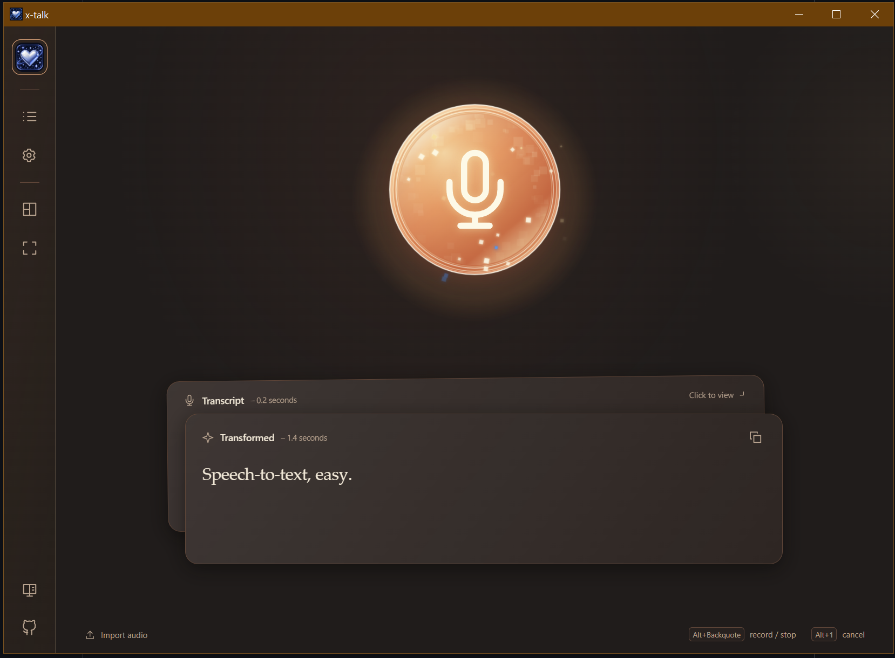

# x-talk

For when the thought is there, but typing it all out... isn't happening.

x-talk is a small Windows dictation app. Hit a shortcut, say what's on your mind, and paste the text wherever you need it. Want a little cleanup first? An optional AI pass can tidy up the rambling. Or leave it in. Your call.

I built this because I wanted a record button, my words, and a little help making them readable. That's pretty much it!

**Windows x64 · English speech · Open source**

[Download for Windows](https://github.com/alexander-north/x-talk/releases) · [Report a bug](https://github.com/alexander-north/x-talk/issues) · [Contribute](CONTRIBUTING.md)



*Dark theme shown with custom shortcuts.*

## Give it a try

You'll need an API key from a supported provider. There's no x-talk account or app subscription; you pay your providers for what you use.

1. Grab `x-talk_<version>_x64-setup.exe` from [Releases](https://github.com/alexander-north/x-talk/releases) and install it. The installer can add Microsoft WebView2 if needed.
2. Open **Settings → API Keys**, add your key, then pick a transcription provider and model in **Providers**.
3. Press **Ctrl+Alt+Space**, talk, and press it again to stop. The microphone button works too.
4. Paste! With automatic copying enabled, your transcript goes straight to the clipboard. You can also copy it from the app.

For cleanup, enable **Transformation** and choose its provider, model, and prompts. The cleaned-up text replaces the transcript on your clipboard when ready; both stay available in the app. Automatic copying is configurable in **Delivery and Sounds**.

**Ctrl+Alt+Escape** cancels. Canceling a recording discards it; canceling processing keeps saved audio and text. Requests already sent to a provider may still incur charges.

<details>
<summary>A few things to know before installing</summary>

The Windows installer isn't publisher-signed yet, so you may see an unknown-publisher or SmartScreen warning. Updater signatures are separate. Don't disable Windows security protections.

Tested on Windows 10 Pro x64; Windows 11 hasn't had a separate hardware acceptance pass. macOS isn't supported yet.

</details>

## A few nice things

- **Less retyping.** Import existing audio, or find an earlier recording to play, edit, export, or retry.
- **Words as you go.** ElevenLabs has an optional real-time mode with a live preview. Imports and retries use batch transcription.
- **Meetings.** Record microphone and system audio, or import audio/video. AssemblyAI creates a speaker-labelled transcript and OpenAI Luna writes the brief. Rename or merge speakers, correct turns, and copy the complete meeting as JSON. Video imports retain only extracted audio. Meeting audio defaults to the latest 50 recordings; text stays until you delete it.
- **A little room on your screen.** Compact mode keeps just the recording controls. Pick a light, dark, or system theme, and adjust sounds and shortcuts to suit you.

Closing the window keeps x-talk in the tray. Use **Quit** to exit, or change that behavior in **Settings → General**. Updates live there too. Versions before 1.5 need one manual upgrade; in-app downloads require public GitHub releases.

If the start sound sneaks into your recording, try headphones or turn that cue off in **Delivery and Sounds**. There's no echo cancellation yet.

## Your keys, your data

**Transcription:** OpenAI, ElevenLabs, AssemblyAI, or Deepgram. **Cleanup:** OpenAI or Anthropic. OpenAI, ElevenLabs, and the AssemblyAI/Luna meeting workflow have had live integration checks; other adapters still need live acceptance.

- Audio goes to your chosen transcription provider. Cleanup sends your transcript and configured prompts/context to its provider. Their pricing, privacy, and retention policies apply.
- Keys stay in **Windows Credential Manager**. The app doesn't load `.env` files.
- Recordings and text stay under `%LOCALAPPDATA%\com.xander.xtalk`. Audio retention is configurable. Deleting local recordings doesn't delete copies already sent to providers.
- No built-in analytics or diagnostic uploads. Diagnostic logs are local, on by default, and exclude credentials, audio, transcript text, and filenames. Find or disable them in General. Review logs before sharing them.

## Found something weird?

I'd love to hear about it. [Open an issue](https://github.com/alexander-north/x-talk/issues), tell me what happened, and what you expected instead. Something feeling confusing is useful feedback too. You don't need to write code to help.

Small fixes and ideas are welcome. For bigger changes, let's talk in an issue first. See [Contributing](CONTRIBUTING.md) for details, or [Security](SECURITY.md) to report a vulnerability privately.

## Build and test

<details>
<summary>Here to tinker? Start here.</summary>

Use Node.js 24.11.1, Rust 1.93.1, Visual Studio 2022 C++ Build Tools/Windows SDK, Python 3.11+, and WebView2. Keep the Windows checkout on a Windows drive, such as `C:\dev\x-talk`.

Prepare the bundled media tools in WSL/Linux with Python, curl, make, pkg-config, and x86_64 MinGW GCC/G++ installed:

```sh
scripts/build-media.sh
```

With separate checkouts, copy the generated `src-tauri/binaries/ffmpeg.exe` and `ffprobe.exe` into the Windows checkout's same directory. Keep platform dependencies and build caches separate; see [Windows/WSL setup](docs/AGENT_WORKFLOW.md#wsl-and-windows-build-workflow).

From the Windows checkout:

```sh
npm ci
python scripts/generate-notices.py
npm run check
npm test
python -m unittest discover -s tests/release -v
cargo test --manifest-path src-tauri/Cargo.toml --features desktop --locked
cargo fmt --manifest-path src-tauri/Cargo.toml --check
cargo clippy --manifest-path src-tauri/Cargo.toml --features desktop,test-providers --all-targets --locked -- -D warnings
npm run desktop:dev
```

- `npm run desktop:ui`: native UI development with a separate persistent profile and simulated providers. The microphone, playback, and clipboard are real. See [UI development](docs/AGENT_WORKFLOW.md#native-ui-iteration).
- `npm run desktop:debug`: debug executable with the UI embedded.
- `npm run desktop:build`: Windows installer in `src-tauri/target/release/bundle/nsis/`.
- Linux core tests: `cargo test --manifest-path src-tauri/Cargo.toml --locked`, with system FFmpeg installed.

For isolated desktop acceptance without microphone or provider requests, run in PowerShell:

```powershell
cargo install tauri-driver --locked --version 2.0.5
./scripts/install-webdriver.ps1
npm run desktop:test-build
$env:XTALK_E2E_OFFLINE = '1'
npm run test:e2e
Remove-Item Env:XTALK_E2E_OFFLINE
```

The setup script downloads the driver matching WebView2. For real microphone, live provider, and installer tests, read [test modes and isolation](docs/AGENT_WORKFLOW.md#native-test-modes-and-isolation) first.

[Product behavior](SPEC.md) · [Agent workflow](docs/AGENT_WORKFLOW.md) · [Releasing](docs/RELEASING.md)

</details>

## License

[Apache 2.0](LICENSE) for original code, prompts, artwork, docs, and synthesized sounds, unless noted otherwise. Third-party dependencies keep their own licenses. See [NOTICE](NOTICE) for attribution and [Releasing](docs/RELEASING.md) for bundled notices and source archives. The license doesn't grant trademark rights or imply endorsement of forks.
