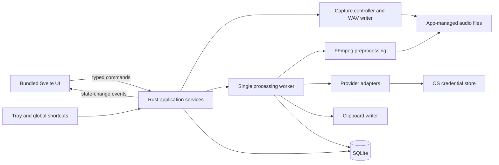

# x-talk product spec

Status: 1.6 release series, with Windows x64 installers, signed in-app updates, and optional ElevenLabs real-time transcription. Main uses the 1.6.0 development baseline; CI assigns each shipped release its own patch version. The requirements below define intended behavior. Section 11 records dated verification evidence and remaining coverage gaps; earlier candidate results are historical, not claims about every current build. AssemblyAI, Deepgram, and Anthropic live acceptance remains deferred.

## Confirmed planning constraints

- The first release is for the owner's personal use on Windows x64. Windows 10 remains a hard requirement; the target edition and build are listed below.
- The project is licensed under Apache-2.0 and is publicly distributed through GitHub Releases. macOS and other operating systems are outside the current release scope.
- Tauri is the agreed desktop framework following comparison with WPF and Avalonia. Use a Rust application core and a bundled Svelte 5/TypeScript UI; supporting libraries and their rationale are specified below.
- Resolve the specification collaboratively before implementation. The first working release must implement all agreed features; internal implementation milestones do not reduce that release's scope.
- Keep the product slim in functionality as well as resource use. Preserve the core record, transcribe, optionally transform, and deliver loop while minimizing configuration, dependencies, and implementation/support complexity. Surface reductions to previously requested features for agreement; prefer straightforward defaults for routine engineering choices.
- Start with fresh application data. Importing another application’s history, settings, or presets is outside scope; the supplied cleanup prompt files are still seeded as specified below.

## Goal

A small, fast, lightweight Windows desktop application for recording speech, transcribing it, and optionally cleaning up the text with an LLM. The initial target machine runs Windows 10 Pro, version 22H2, OS build 19045.7807. It runs locally, launches on startup, and stays available in the background. Transcription and transformation use the configured external providers.

The primary workflow is: press a global hotkey, speak, press the hotkey again, and receive usable text on the clipboard for manual pasting. Automatic cursor insertion is outside the first-release scope. The application is a Tauri desktop app with a Rust core and bundled TypeScript UI. It is not a hosted web app.

## Recording and processing

### Optional real-time recording

- Settings → Providers offers After recording (the default for existing and new profiles) and Real-time · ElevenLabs. Real-time microphone recordings use `scribe_v2_realtime`; the existing `scribe_v2` choice remains the batch model for imports and explicit transcription retries. Other providers support after-recording mode only. Changing provider away from ElevenLabs returns recording mode to After recording.
- Capture the mode and vocabulary hints when recording starts. Save the complete original locally while sending mono 16-bit PCM through a bounded native streaming worker. Use a supported device sample rate, preferring the current format when supported, otherwise 48 kHz. Compression, silence removal and temperature apply only to batch requests. Real-time vocabulary hints accept at most 50 phrases; the provider's keyterm surcharge still applies.
- Show provisional text while speaking in the existing transcript card, labeled Live preview, with no Copy action enabled. Replace partial text as it changes; append only confirmed segments. Deliver nothing until normal Stop has drained captured audio and the final segment has been confirmed. Then save the complete transcript and use the existing per-stage clipboard, sound and optional transformation behavior.
- Keep the recording controls unavailable during finalization. The transcription time for real-time results measures Stop to final confirmation, including local finalization; batch timing continues to exclude audio preparation. History records the actual real-time model used.
- Use manual segment commits at a pause after 20 seconds, or at 30 seconds to stay below the provider's automatic boundary. Await each commit before sending the next segment. Pad a final segment shorter than two seconds with silence to satisfy processing startup. This padding is sent to the provider and may be billable; it is not added to the retained original.
- A connection failure, backlog, timeout or invalid response must never promote a provisional transcript or silently retry a paid request. Continue local recording, show the streaming error, retain the original after Stop, and offer explicit batch retry from Recordings. Preserve confirmed completed results across interrupted admission; restart recovery never automatically sends audio or copies text.
- Cancel discards the active recording and preview, closes streaming, and prevents subsequent transformation or delivery. In real-time mode it cannot recall audio already transmitted or prevent charges for it. Stop-and-quit preserves admitted audio and completed text for recovery; discard-and-quit follows Cancel.
- Acceptance covers live-preview replacement, normal Stop and final flush, Cancel, Stop-and-quit, failed connections, queue overflow, partial-only responses, long recordings with multiple commits, settings snapshots, import/retry routing, persisted final results and clipboard eligibility. Mock transport and isolated native acceptance are required; live accuracy and latency remain an explicit provider acceptance step using representative recordings.

### Shared recording behavior

- A configurable global hotkey toggles recording. A second configurable hotkey cancels recording; there is no separate Stop shortcut. Either binding may be removed.
- Stopping a recording starts transcription automatically, followed by transformation if enabled.
- Canceling an active recording discards it and prevents further transcription/transformation. Real-time mode may already have transmitted audio as described above. During processing, Cancel stops remaining local work and preserves admitted original audio and any completed text. Already submitted provider requests may still complete remotely or incur a charge. Canceled jobs never automatically resume or deliver late results. Their original audio stays retained until explicit deletion; retry is a separate deliberate action.
- Allow one operation at a time across recording, import, retry, resumed processing and transformation tests. Block new work until the current operation, including optional transformation, completes or cancellation is acknowledged. Apply admission checks in native commands shared by the UI, tray and shortcuts. History, navigation and copying saved text remain available.
- Process completed recordings, imports, and requested retries one at a time, in submission order. A recording's transcription and optional transformation finish before the next job starts. New operations are refused while processing is active, rather than silently queued. Legacy resumed jobs retain submission order. Eligible automatic outputs follow this same order.
- Capture provider, model, selected preset and its contents, transformation enablement, preprocessing, and delivery settings when recording starts, or when an import/retry is requested. Later settings changes affect new work; existing jobs use their captured settings.
- The user can select a Windows microphone device. Bitrate is an internal encoding choice; there is no configurable bitrate control in the first release.
- Optional compression and silence removal apply to a temporary upload copy, preserving the complete original for playback, export, and future retries. The implementation plan defines the encoding strategy and validation of conservative silence filtering.
- Uploading an existing audio file runs the same transcription and optional transformation flow. Recordings and imports are limited to 60 minutes of original audio, measured before silence removal. Accepted formats and file-size limits are defined in the implementation plan.
- Produce a single transcript without diarization, speaker labels, or per-speaker channels.
- The first release supports English speech, with no translation stage. Non-English speech is outside the supported workflow; an English language hint is not a guarantee that such input will be translated into English.
- A failed job identifies the affected stage, preserves saved work, and allows the next queued job to proceed. Offer manual retry from history. A transformation failure does not trigger a fallback copy; any transcript already copied after transcription remains available.
- Preserve unfinished jobs across application restarts, but leave them paused until the user explicitly chooses Resume. Paused work does not block fresh recordings or processing. Explicitly resumed jobs append to the active queue, preserving their original relative order and settings snapshots. Resumed jobs save results to history without automatic clipboard copying. Requests interrupted in flight follow the recovery rules below.

Use one native CPAL recording backend; FFmpeg handles media preparation and playback decoding. Browser recording and alternate recording backends are outside scope. Validate this approach against Windows device support, startup time, memory use, encoding, and packaging in M0.

## Text delivery and sounds

- Transformation is optional. With transformation disabled, only the raw transcript is produced. With transformation enabled, both outputs remain available in history; automatic copying follows the independent stage toggles below.
- Raw and transformed output each have an independent automatic copy-to-clipboard toggle. Copy each enabled stage after saving it: raw transcription first, then transformed text when ready. A disabled stage leaves the clipboard untouched.
- Automatic clipboard copying applies only to the initial processing of a new microphone recording within the current application session. Imports, manually requested retries, and jobs resumed after restart save their results in history without automatic clipboard copying, regardless of the output delivery settings. Their results can be copied explicitly from history.
- Enabled automatic copying intentionally replaces the current clipboard, even if the user copied something else while processing was underway. Accept this behavior without clipboard-change detection, preservation, or restoration. Saved results remain available through explicit Copy actions.
- Five separate event sounds are independently controllable: recording started, recording stopped, recording canceled, transcription completed, and transformation completed. Each can be enabled or disabled without affecting the others. Use the original synthesized sound family: a 400 ms C4–D4–F4 recording phrase, 330 ms falling three-tone stop with decisive lower landing, 320 ms low three-tone cancellation (E3–D3–C3, short–short–long), 440 ms rising transcription phrase (G4–A4–C5), and a 350 ms transformation phrase (392–494–988.5 Hz). Keep a shared warm, rounded resonator with restrained upper harmonics, smooth attacks and dry tails. Keep restrained levels and a distinct high final transformation tone; provide a Preview button per cue in Settings. Preview plays explicitly even when the event toggle is off, without saving settings or creating a job.
- Transcription-complete and transformation-complete sounds can both play when both are enabled and both stages succeed. Selecting transformed text for delivery does not suppress the transcription-complete sound. A skipped transformation does not trigger its completion sound.
- Imports and retries play the enabled completion sound for each stage that succeeds. They do not trigger recording-started, recording-stopped, or recording-canceled sounds.

## Desktop UI

- Open on a recording-focused home view with the existing left rail, overlapping text cards and footer. A large coral/champagne glass control carries the recording and processing states; small electric-blue pixel highlights provide contrast. Idle squares vary in size/color, appear, drift radially outward along straight paths and fade with a slow pulse. Recording shows a real microphone frequency spectrum around a stable Stop control; its height and color follow speech. Transcription has an interior reflective gold/champagne/bronze iris with a near-continuous band of tightly packed facets and gently varying segment widths; independently rotating square particles travel along circular arcs inside and outside the perimeter, fading in and out. Transformation becomes a rounded square with a central star pulsing from its original size to twice that size without rotation; varied square particles drift radially outward. Completion returns to a circle with a gently pulsing checkmark and star-shaped perimeter particles that appear, grow and fade. The completion celebration lasts five seconds, ends earlier after a successful manual copy or new operation, and never holds the operation lock. Automatic copying does not dismiss it; saved startup history does not replay it.
- Position the full-workspace control center roughly 26% of the viewport height from the top, with responsive compact sizing. Use large central glyphs and a tightly arranged iris inside the glass, doubled recording-bar lengths, and the full frequency range mirrored across four quadrants. About one-quarter of recording bars crossfade to electric blue at changing seeded positions. Reserve space below the maximum bar reach for output cards. Show a soft light-blue elapsed timer inside the recording Stop square. Run transcription and transformation motion at 1.5 times the initial draft speed.
- Recording bar response has an additional 2× gain for more visible average activity, capped at the existing maximum reach to retain card clearance.
- Remove visible stage labels beneath the control. Keep stage announcements available to assistive technology, with elapsed time visible only inside the Stop square. Crossfade state glyphs and glass treatments; preserve card slot geometry, fade result text and incoming/outgoing cards, and suppress stale previous-result flashes during admission. Concentrate transcription sparkles outside the glass while retaining some near the iris. Cancel remains a small lower-right satellite while recording or processing, including transformation, and disappears when idle or complete. During cancellation show a non-startable state until the native worker releases the operation. Import stays bottom-left and shortcut hints bottom-right. Preserve ordinary keyboard button behavior and honor reduced motion with a static glass treatment and no particle travel or pulsing.
- Warm ivory surfaces, champagne reflections and burnt-orange shadows surround the glass control. Use readable humanist sans-serif transcript text and a contrasting readable serif for transformed text. A subtle cursor-positioned light affects the surface; reduced motion disables it. Retain dark mode, compact mode and native title-bar behavior. Frequency analysis uses the existing native microphone stream on the writer thread, with bounded buffers and a separate lightweight spectrum event, never browser microphone capture or metadata polling.
- Show the latest transcript in a card beneath the recorder. With transformation enabled, its result arrives as a second card overlaid slightly down and right, bringing the transformed text forward. Clicking the exposed rear card swaps the cards with a brief easing/tilt animation; it is also reachable with Tab/Enter. Keep only the foreground text/copy control interactive and visible, and preserve a manual choice through ordinary state refreshes. A new recording/result resets the automatic front selection. With transformation off, or while waiting for its result, show just the transcript card. Honor reduced-motion preferences. The entire foreground card is a keyboard-accessible Copy button with a pointer cursor and copy/check icon. It copies the complete saved text, even when the preview is truncated. The exposed rear card only swaps cards. Cards are about 25% taller, extending downward; transformed text is 20% smaller than the earlier glass design. Show the last lines that fit, replacing hidden leading text with an ellipsis, without internal scrollbars or editing. Recalculate on text updates, font loading, and resize; live preview also follows the text ending. Label the cards Transcript and Transformed, with a small muted elapsed-time suffix such as “– 0.5 seconds” when measured. Persist each successful provider-stage duration alongside its saved result, measured with a monotonic clock and excluding queue wait and audio preparation; async resume measures the successful resumed polling attempt. Preserve the previous successful result/time after failure. Hide timing for legacy unmeasured results and clear raw timing after a manual transcript edit.
- Use a single narrow left icon rail: the supplied Cosmic Chrome Heart icon opens the recorder, a list icon opens Recordings, and a gear opens the existing settings. Window controls switch compact/full workspace and full-screen mode; Escape exits full screen. An Auto → Light → Dark appearance control and a link to `https://github.com/alexander-north/x-talk` sit at the bottom. No top navigation or static English-speech/local-history/transformation footer.
- Compact mode shows recording controls and shortcut hints only, hiding both output boxes and import. It uses a small native window (target 420 × 380 logical pixels); expanding restores the full workspace and saved outputs. Opening Recordings or Settings from compact mode expands the window. Restore compact presentation when reopening a saved small recording window.
- Day and night modes use warm ochre, sand, butterscotch, desert-rock, and dark earth tones with burnt-orange accents. Theme switching in the rail saves immediately and preserves other unsaved settings edits.
- An always-on-top toggle.
- Recordings replaces the old history list/detail split with a table, and retains settings for recording, transcription, transformation, API keys, sounds, shortcuts, output delivery, and retention. Settings sections appear as tabs within the settings view.
- Start at login with a tray icon; opening the main window at startup is unnecessary.
- Distinct idle/recording tray states and the configured event sounds provide background feedback. Play the recording-started sound only after capture is ready. Show elapsed time, processing state, and copy status in the existing window; no separate floating overlay is required. Stage-completion sounds do not imply that clipboard copying succeeded.
- Closing the window leaves the application running by default. This behavior is configurable.
- Remember the window position, size, and always-on-top setting across restarts.

API key removal requires a small confirmation dialog naming the service; cancel leaves the saved key intact. Settings success messages (including key saved/removed) clear after two seconds. Errors remain visible until resolved or dismissed.

## Recording history

Each saved entry shows its title (initially the recording date/time or imported filename), duration, raw-transcript word count, transcript, and transformed output when available. Show the date only once. Legacy subtitles remain stored for compatibility but are not displayed or edited.

The Recordings table searches only raw transcript and transformed text across the entire saved library, with literal case-insensitive English matching. Sort ascending/descending by timestamp or available text/numeric metadata. Default to 50 results per page, with a 25/50/100 page-size selector. Columns can be shown/hidden, reordered, and resized by dragging or with arrow keys, with preferences retained locally. Default columns show recording, transcript, transformed output, audio, and actions. Optional columns expose source, duration, original byte size, provider model IDs, and recording ID. Fit columns to the window; narrower windows use labeled recording cards, never horizontal scrolling. Text previews show roughly three lines with an ellipsis; Copy always copies the entire saved value, and clicking a preview opens the full text. Do not display redundant success/copy status, automatic excerpts, or an Import button in this view. Outline the complete search field on focus.

Available actions:

- Play/pause the saved original using an embedded player with elapsed/total time and a seek bar. Pause retains position; seeking preserves the paused/playing state. Playback uses the existing bounded native decoder/output path and audio lease, without exposing arbitrary filesystem paths to the UI.
- Copy the transcript or transformed output separately.
- Retry transcription or retry transformation separately.
- Edit title and raw transcript in a modal; preserve any legacy subtitle. Validate the entry revision and save atomically. A changed transcript increments its text revision, preserves previous transformed output, and marks that output out of date. Transcript changes are blocked while processing or recoverable work is pending; metadata-only edits remain possible. No provider request or automatic copying occurs when editing.
- Download/save the recording to a chosen location.
- Delete the recording.

Clear All on the Recordings page requires explicit confirmation and clears the entire library across all filters/pages: recording metadata, text, managed audio, and paused/unknown jobs. Preserve imported source files, credentials, transformation configuration, and other settings. Disable clearing during active recording or queued/running processing; stop playback on confirmation and reject active audio leases/import reservations at the storage boundary. Mark the complete library for deletion in one transaction, then use durable managed-file cleanup with safe retry after unlink failures. The Actions header stays sticky with the other table headers and uses the same opaque header background.

History remains accessible across application restarts. A microphone recording's initial title is its recording date/time; an import's initial title is its source filename. Do not generate new subtitles. Titles are generated locally without an additional AI request and remain editable.

Retry behavior:

- Retry transcription runs only transcription and replaces the saved transcript on success. Any existing transformed output remains available but is marked "out of date" until transformation is explicitly retried successfully.
- Retry transformation uses the current saved transcript and replaces the saved transformed output on success.
- Both actions capture the current relevant settings when requested, as specified above. A failed retry preserves the previously saved text and its status; existing text remains available while a retry is pending or running.

Audio storage and retention:

- Keep the complete original audio in app-managed storage. Playback and export use that original. Compression and silence removal operate on temporary upload copies, which are cleaned up after use.
- Copy imported audio into app-managed storage. Retention and entry deletion must never modify or delete the user's source file.
- Default to keeping audio for the latest 100 recordings. The user can change N or select "keep everything." Recordings and imports count toward N in creation order; retries do not make an entry newer, and canceled recordings do not count.
- Beyond the retention limit, delete only audio; retain transcripts, transformed outputs, and entry metadata. Playback, audio export, and transcription retry are unavailable when audio is no longer retained. Transformation retry remains possible using the saved transcript.
- Protect audio needed by queued, running, or paused recoverable jobs from retention deletion. Audio may temporarily exceed the configured count; reapply retention once protection ends. Discarding paused work releases its audio protection while preserving saved history and text.
- Explicit entry deletion requires confirmation and removes its app-managed audio, transcript, transformed output, and metadata. Disable deletion while that entry has queued or running work in the first release.

## Transcription settings

Initial provider choices:

- OpenAI
- AssemblyAI
- ElevenLabs
- Deepgram

The user can select a provider, choose an appropriate model, and configure its API key. Audio compression and silence removal are configurable; bitrate is not. Configure English speech recognition where supported by the selected model. Translation and diarization are outside the first-release scope.

Expose temperature and transcription prompt/context controls only where the selected service/model supports them. Keep vocabulary/context hints separate from transformation system prompts. Verify each provider's current models, capabilities, and upload constraints when implementing its adapter.

## Transformation settings

Initial provider choices are OpenAI and Anthropic. The user can choose the provider and model, configure an API key, and control the temperature and system prompt where supported.

The default use case is cleaning up verbal tics and transcription artifacts. The transformation is configurable rather than hard-coded to this behavior.

The configuration view includes:

- Separate editable system and user prompts. In the user prompt template, replace `{{input}}` with the transcript as text; do not interpret transcript contents as template code.
- A test input area for pasted text, a run action, and a visible output area.
- A way to enable or disable transformation in the normal recording workflow.

The transformation model catalog spans fast/economical and more capable choices: OpenAI GPT-6 Luna (existing recommended default), GPT-5 nano, GPT-5 mini, GPT-5.4 mini, GPT-6.1 Sol, GPT-6 Astra; Anthropic Claude Haiku 5.5, Sonnet 5.5, and Opus 5.5. Thinking choices follow model capabilities. Existing presets/jobs without the new optional reasoning field keep their previous fast behavior. Model changes reset reasoning to that model's fast supported level and clear incompatible temperature; thinking-enabled requests omit temperature. Thinking tokens share output limits and have a reserved budget. Sonnet's Off uses `between_tools`, Haiku's uses `disabled`, and Opus always uses adaptive thinking. Account/model access and new-model dictation quality require human testing; adding options does not establish live-provider success. Capability sources: [OpenAI models](https://developers.openai.com/api/docs/models), [reasoning](https://developers.openai.com/api/docs/guides/reasoning), [Claude models](https://platform.claude.com/docs/en/models/overview), and [Claude thinking](https://platform.claude.com/docs/en/build-with-claude/thinking).

Expose one transformation configuration with provider, model, thinking, supported temperature, system prompt, and user prompt. Remove preset names/descriptions, lists, cloning, deletion, and active-selection controls. When enabled, this one configuration produces one transformed result. Provider/model/thinking choices save immediately; prompts retain explicit Save and unsaved-navigation protection. Label the tab Transformation and the test panel Try this transformation.

On upgrade, use the previously active configuration, including a custom preset rather than assuming the seed. Preserve other legacy presets in storage as archives, and preserve existing history and queued-job snapshots. The public state exposes one transformation document without preset identity/name/description; commands save and test that configuration only. Remove preset collection mutation commands from the desktop command allowlist, and reject attempts to switch the legacy selected ID through settings. Keep internal legacy IDs/metadata for compatibility; no destructive database conversion is needed.

The initial cleanup configuration uses the user's supplied [system prompt](prompts/conservative-cleanup.system.md) and [user prompt template](prompts/conservative-cleanup.user.md), preserved verbatim. Its purpose is conservative cleanup with minimal wording changes, preserving meaning and conversational voice. Treat transcript content as source text rather than instructions, and return only the cleaned transcript in plain Markdown.

Transformation tests show elapsed time from clicking Run test until the result returns, including any queue wait, in small muted text beside Test output. Clear the previous time when starting another test or selecting another preset. Transformation tests show their output only in the test panel, with an explicit Copy button. They do not create recording-history entries, automatically copy to the clipboard, or play completion sounds.

## API keys

A per-service API key view supports adding/replacing and deleting one key per provider. OpenAI transcription and transformation share the same OpenAI key. Store keys in Windows Credential Manager behind the Rust credential interface; keys must stay out of Git and application diagnostics.

## Acceptance criteria for development

- A packaged Windows 10 application can start at login in the tray and record through its global shortcuts while another application has focus.
- Recording, stop, and cancel work with the chosen device; imported audio follows the same processing path.
- Both microphone recordings and imports support up to 60 minutes of original audio. No user-facing bitrate setting or diarization controls are present. Optional silence removal changes only the upload copy; playback/export preserve the original.
- Every initial provider can complete its relevant stage with a valid configured key and supported model.
- Transformation can be bypassed, configured through one provider/model/prompt form, and tested with pasted text. It produces one transformed output per run. The supplied cleanup prompts seed the initial configuration.
- With transformation enabled, only transformed output is delivered automatically. With transformation disabled, the transcript is delivered instead. Text delivery settings do not couple or override sound settings.
- Raw and transformed automatic-copy toggles are independent. Each stage’s toggle controls its own copy; disabling one does not disable the other. When enabled for an eligible recording, completion replaces even clipboard content copied while processing was underway; no overwrite prompt or restoration is added. Cursor-insertion controls are absent, and the app never injects text or paste shortcuts into other applications.
- Each of the five event sounds follows its own enable/disable setting, including separate transcription-complete and transformation-complete sounds during the same workflow.
- New recording, import, retry, resume and transformation-test actions are blocked until the current operation finishes or acknowledges cancellation. Cancel discards an active capture; during processing it stops remaining stages and preserves admitted audio and completed text. Legacy resumed jobs process in submission order.
- Changing provider, model, transformation prompts, transformation enablement, preprocessing, or delivery settings after a recording starts does not change that recording's job. Imports and retries capture settings when requested.
- Imports and retries update history and play enabled stage-completion sounds without automatic clipboard copying. Preset tests show output in the test panel with an explicit Copy button, without history entries, automatic delivery, or completion sounds.
- History persists and supports every listed action. Retention deletes old audio while preserving text, and canceled recordings leave no saved recording.
- Transcript and title are editable in the revision-checked recording modal; legacy subtitles are preserved silently. A successful transcription retry marks any existing transformed output out of date without automatically rerunning transformation. Failed retries preserve previously saved text.
- Retention defaults to the latest 100 recordings and supports a configurable count or keeping everything. Queued/running/paused recoverable work retains needed audio until completion or discard; playback and export use the complete original, and imported source files remain untouched.
- Confirmed entry deletion removes all of that entry's app-managed audio, text, and metadata. Deletion is unavailable while the entry has queued or running work.
- Day/night mode and always-on-top work. Closing the window keeps the app running by default; window position, size, and always-on-top persist.
- Failures identify the affected stage, preserve saved work, and allow later queued jobs to proceed. Manual retry is available when the required source data remains retained; transformation failure never falls back to automatic raw-transcript delivery.
- Unfinished jobs survive restart in a paused state without blocking fresh work or consuming active queue slots. Explicit Resume appends them behind already queued work in their original relative order, keeps their snapshots, and never automatically copies their results. Repeated Resume cannot enqueue duplicate work. Discard releases audio pins without removing saved text.
- English speech completes the supported workflow without a translation stage. OpenAI uses one shared provider key for transcription and transformation. Initial titles are generated locally and remain editable.
- Tray state reflects actual capture while the window is hidden; the start sound never precedes capture readiness. Elapsed time, processing state, and copy status are available in the existing window. No floating overlay or migration from another application is required.
- Before handoff, exercise the full record-to-output flow on Windows, global shortcuts, background behavior, audio playback, clipboard copying, retention, and provider failures. Report any verification that cannot be completed, including live provider checks without supplied keys.

## Desktop architecture decision

Selected: [Tauri](https://v2.tauri.app/concept/process-model/), targeting Windows x64 first. Its reusable UI and Rust core provide a path to future macOS and Linux versions. The tradeoffs are maintaining Rust and TypeScript code, a webview runtime dependency, and platform-specific desktop integrations. Compared alternatives were [WPF](https://learn.microsoft.com/en-us/dotnet/desktop/wpf/overview/) (Windows-only .NET UI) and [Avalonia](https://docs.avaloniaui.net/docs/platform-specific-guides/windows/) (cross-platform .NET UI).

Recording, job processing, persistence, credentials, and text delivery belong in the Rust core. The UI displays state and issues commands; closing the window must not stop capture or processing when background operation is enabled. Isolate operating-system integrations so future ports can replace them without rewriting workflow logic. The implementation plan follows below.

Installer size, idle memory, and recording responsiveness need separate measurement; no performance figures have been established. The first technical milestone must verify a packaged tray application on the target machine, including microphone capture, global shortcuts, clipboard copying, startup time, and total memory including WebView2 processes.

Compatibility research, checked 2026-10-15: Microsoft's [modern .NET support matrix](https://learn.microsoft.com/en-us/dotnet/core/install/windows) does not list Windows 10 Pro 22H2 as supported. This is distinct from whether a packaged WPF or Avalonia application runs on the target machine. Rust's [Windows MSVC target requirements](https://doc.rust-lang.org/stable/rustc/platform-support/windows-msvc.html) include Windows 10, and Microsoft's [WebView2 lifecycle guidance](https://learn.microsoft.com/en-us/deployedge/microsoft-edge-support-lifecycle) states continued Windows 10 22H2 updates through at least October 2028. These documents inform the framework comparison; they do not substitute for testing the packaged application on the exact target machine.

## Implementation plan

The following engineering choices and initial defaults implement the agreed product above. All four transcription providers and both transformation providers remain in the first release. Milestones are internal checkpoints; the release is complete only after all agreed features and their acceptance checks pass. Technical candidates and tuning values are explicitly identified where verification is still required.

### 1. Tooling and dependency decisions

| Area | Implementation choice | Reason and tradeoff |
| --- | --- | --- |
| Desktop host | Tauri 2, Windows x64 MSVC target | Agreed direction. Keep one application core and use the OS webview for UI. Pinned Rust/JS host 2.12.4 and CLI 2.12.3. |
| UI | Svelte 5, TypeScript, Vite, plain CSS with theme variables | Suits a small reactive desktop panel. Avoid a server framework, application router, and separate global state library. React would be reasonable for a React-experienced maintainer; there is no such preference here. See [Svelte](https://svelte.dev/docs/svelte/overview) and [Tauri's Vite integration](https://v2.tauri.app/start/frontend/vite/). |
| Audio capture/output | CPAL, WASAPI on Windows; Hound for WAV writing | Native capture remains independent of window/webview lifecycle. CPAL offers a future CoreAudio path on macOS. Match APIs to the pinned release rather than copying examples from its development branch. See [CPAL](https://github.com/rustaudio/cpal). |
| Media processing | Bundled FFmpeg and ffprobe executables, invoked only when needed | One established implementation for probing, decoding imports, resampling, encoding, silence filtering, and playback decoding. Costs installer space, but avoids separate codec stacks and handwritten audio filters. Bundle tested binaries; users install no media tools. See [Tauri sidecars](https://v2.tauri.app/develop/sidecar/). |
| Persistence | SQLite through rusqlite, bundled SQLite, explicit SQL migrations | Transactions cover history and queue state without a database service or ORM. Keep database access on one dedicated worker. See [rusqlite](https://docs.rs/rusqlite/latest/rusqlite/). |
| Async work and HTTP | Tauri's Rust async runtime, reqwest, serde/serde_json | One HTTP stack with small provider-specific adapters, streamed file bodies, and explicit deadlines. No general AI orchestration framework or six separate SDKs. See [reqwest](https://docs.rs/reqwest/latest/reqwest/). |
| Credentials | Windows Credential Manager through the Rust windows bindings | Uses the current user's OS credential store without another master password or a custom encryption format. Hide behind a small CredentialStore interface for future ports. See [CredWriteW](https://learn.microsoft.com/en-us/windows/win32/api/wincred/nf-wincred-credwritew). |
| Desktop integration | Official Tauri global-shortcut, autostart, single-instance, dialog, clipboard-manager, and window-state plugins; core tray APIs | Reuse focused integrations. Clipboard copying needs no native input-injection module or destination-window tracking. No broad filesystem or shell API exposed to the UI. |
| Testing | Rust unit/integration tests, Vitest for UI logic, WebdriverIO with tauri-driver for packaged Windows flows | Test workflow logic without providers; separately test the real desktop host. Browser-only tests do not prove shortcuts, audio devices, or clipboard copying work. See [Tauri WebDriver](https://v2.tauri.app/develop/tests/webdriver/). |
| Build/release | npm with a committed lockfile, Cargo.lock, pinned Rust toolchain, Windows CI, Tauri NSIS installer | A per-user installer and manual upgrades are sufficient initially. Use WebView2 Evergreen bootstrapper support rather than bundling a fixed runtime. See [Windows installer guidance](https://v2.tauri.app/distribute/windows-installer/). |

Exact dependency versions are committed in package.json, Cargo.toml, and their lockfiles. Rust is pinned to 1.93.1; capture uses CPAL 0.17.0 for stable device identifiers; rusqlite 0.40.2 bundles SQLite 3.53.2. Keep the matching JavaScript/Rust Tauri packages compatible. Treat model availability and API parameters as versioned adapter data, not assumptions baked into UI components.

For media binaries, record upstream version, build configuration, checksums, and corresponding source/notice locations. Prefer an audio-focused build using native AAC and no unnecessary GPL/nonfree components. Review the actual distribution against [FFmpeg's redistribution guidance](https://ffmpeg.org/legal.html); do not assume every downloaded FFmpeg build has the same license or codecs. Public release also needs an owner-selected project license and signing decision.

### 2. Runtime boundaries and repository layout



This is one Rust application process plus the webview's processes and temporary media subprocesses. There is no local HTTP server, Windows service, message broker, or hosted backend.

Repository layout (Rust boundaries use modules within one crate):

```text
src/                         Svelte views, components, typed IPC client
src-tauri/src/
  app.rs                     composition and application lifecycle
  commands.rs                validated UI command boundary
  domain/                    states, snapshots, errors, delivery policy
  capture/                   CPAL stream, bounded buffer, WAV writer
  media/                     probing, encoding, silence removal, playback
  jobs/                      scheduler, stage transitions, recovery
  providers/                 transcription and transformation adapters
  storage/                   SQLite repositories and file lifecycle
  credentials.rs             Windows Credential Manager boundary
src-tauri/migrations/        numbered SQL migrations
src-tauri/capabilities/      explicit permissions for the local UI
src-tauri/binaries/          build-populated, checksum-verified media tools
src-tauri/tests/             workflow, media, and opt-in live tests
tests/e2e/                  packaged Windows workflow tests
prompts/                    existing cleanup prompts, unchanged
scripts/                    build and dependency-verification scripts
.tmp/                       ignored experiments, logs, and test artifacts
```

Keep a single Rust crate with modules initially. Introduce interfaces only at actual test/platform boundaries: AudioCapture, MediaProcessor, TranscriptionProvider, TransformationProvider, CredentialStore, ClipboardWriter. Capture duration is bounded by captured sample count; UI elapsed time does not control the cap. Do not build a user-installable provider plugin system.

The UI is a projection of Rust-owned state. Commands include start/stop/cancel recording, import, list/get history, retry a stage, edit metadata, delete/export/play audio, manage the single transformation/settings/keys, test the transformation, and resume interrupted work. Use entry IDs and revision tokens for mutations. Return structured errors with stage, safe message, and allowed recovery action. Events invalidate relevant UI state; initial load and reconnection fetch authoritative snapshots so missed events cannot lose jobs.

### 3. Recording and media pipeline

1. On Start, validate the selected device, available queue capacity, required provider keys, and available disk space. Reserve a queue slot and capture the settings snapshot. Device selection supports an explicit device or the current system default; an unavailable explicitly selected device produces an actionable error rather than silently switching microphones.
2. Open a shared-mode input stream using a supported device format. Copy samples into a preallocated bounded buffer; a dedicated writer drains it to a temporary WAV file. No filesystem, network, SQLite operations, or waiting for locks in the audio callback. Use a monotonic clock for duration. Writer errors, stream errors, and buffer overflow must reach the capture state machine; stop capture, preserve recoverable audio, and report an interrupted recording rather than silently submitting incomplete audio as successful capture.
3. Preserve the complete captured timeline in the original WAV at the negotiated sample rate/channel layout. Encoding/downmixing for upload happens later. Bound supported capture formats and negotiate alternatives rather than assuming every device supplies 16-kHz mono audio.
4. On Stop, drain and finalize the WAV, release the microphone, atomically rename the file, then commit the entry and queued job. Publish RecordingStopped only after a usable file exists. On Cancel, persist cancellation intent in the capture journal before cleanup; discard the file and reservation without creating a history entry or a provider job.
5. Probe imports before accepting them, then copy the source into app storage and queue it. Verify actual media streams and duration; do not trust extensions. Preserve original filenames only as metadata, using generated IDs for storage paths.
6. The worker uses one FFmpeg invocation to decode the input and write an untrimmed mono 24 kHz PCM validation copy alongside the optional filtered/encoded upload. Both outputs share input decoding; conversion is configured per output using the existing bundled filters. Validate the full untrimmed decoded duration and samples before any upload, as well as container metadata. Never validate only the silence-shortened derivative. Run media tools with fixed argument arrays, local file inputs, bounded output capture, and a deadline; do not pass filenames through a shell. Supervise subprocesses and terminate them on timeout or shutdown; use a Windows job object or equivalent tested parent-lifecycle handling to avoid orphan media processes.
7. Stat and validate the final upload before opening a provider request. A provider size/duration limit failure is a local preflight error, not an expensive failed upload. Stream the file; never load an hour of audio into memory.

Initial media defaults:

| Setting | Initial behavior |
| --- | --- |
| Duration cap | Auto-stop and queue a microphone recording at exactly 60 minutes. Reject longer imports before upload; never silently truncate imports. |
| Import support | Audio-only WAV, MP3, M4A/AAC, and FLAC; at most two channels, 60 minutes, and 1 GiB source size. Explain which limit failed. Video, URLs, playlists, and multitrack selection are outside this release. |
| Compression | Enabled by default. Encode a temporary mono AAC-LC M4A at 24 kHz and 48 kbps. Keep the existing on/off compression setting; disabled uses a PCM WAV upload copy and can exceed a provider's limit on longer recordings. Show a prompt to enable compression, preserving the original for retry. |
| Silence removal | Optional, initially off; one toggle with conservative internal settings. Shorten only long near-silent intervals, preserve boundary padding, and avoid filtering short natural pauses. No sensitivity controls in the first release. |
| Empty/silent input | If preprocessing yields no usable audio, mark No speech detected, retain the original, and skip provider calls, transformation, and automatic delivery. |
| Playback | Decode the retained original to a bounded PCM stream for native playback. Stop playback when recording starts to avoid recording the application's own playback. |

The [FFmpeg silence filter](https://ffmpeg.org/ffmpeg-filters.html#silenceremove) supports duration thresholds and retained silence. Start evaluation around pauses longer than 1.5 seconds with approximately 250 ms of padding; determine the amplitude threshold using quiet-speech/noise fixtures. These are tuning candidates, not proven speech-preservation guarantees. A speech detector would be a fallback only if conservative filtering fails the acceptance corpus. Silence removal must not be required to fit a 60-minute upload.

[OpenAI file transcription](https://developers.openai.com/api/docs/guides/speech-to-text) documents a 25 MB limit and M4A support. At 48 kbps, 3,600 seconds contains 21,600,000 bytes before container overhead. Use an internal 24,000,000-byte ceiling for the compressed upload and still apply each adapter's exact limits. If an encoder output exceeds the ceiling, fail preflight with a recoverable error; do not silently split, truncate, or repeatedly transcode it.

Planning experiment: using Ubuntu FFmpeg 6.1.1, a 3,600-second synthetic pink-noise input (24 kHz, amplitude 0.1, seed 42) encoded as mono AAC at 48 kbps with M4A fast-start metadata produced a 22,014,305-byte file. This establishes size feasibility for that encoder/input only. It does not establish speech accuracy, provider acceptance, or Windows compatibility; this system binary is not the proposed Windows distribution. Before shipping, validate the bundled Windows encoder, all four providers, quiet speech, continuous speech, and the 60-minute boundary. If a provider/model cannot accept the required duration, that is a release blocker to resolve explicitly rather than silently reducing the agreed cap.

### 4. State machines, queue, and recovery

Capture states: Idle → Starting → Recording → Finalizing → Idle. Cancel routes Recording → Discarding → Idle. Failure releases the device and reports the reason. Toggle/Stop/Cancel commands are serialized; repeated key-down events do not create multiple sessions. Stop while idle does nothing. With no active capture, Cancel stops processing and retains completed work; new capture remains blocked until cancellation is acknowledged.

Job stages: Queued → PreparingAudio → Transcribing → Transforming (if requested) → ReadyForDelivery → Complete. Stage-only retries skip unrelated stages. Failures persist Failed with the failing stage and then release the worker for the next job. A failed delivery does not invalidate successful transcription/transformation.

Scheduler rules:

- One complete processing pipeline at a time; capture has its own thread and remains responsive. Provider polling occupies the current job's queue turn but consumes no busy-wait CPU.
- Up to 20 admitted recording/import/retry jobs, counting queued/running jobs and the active capture reservation. Paused jobs do not consume active queue slots, so a recovered backlog cannot prevent fresh dictation. Reject additional active work with a clear queue-full message before recording/import begins. Paused jobs remain visible and retain their required audio until resumed or discarded; the active cap is not a total disk-space cap. A capture reserves capacity, not processing order; it joins FIFO processing when stopped and queued.
- Only one queued/running/recoverable job per history entry. Disable duplicate retry commands and enforce this in Rust and the database, not just the UI.
- Preset tests use the same worker and wait their turn. Permit one pending test; its input/output exists only in memory and disappears on exit. It never enters recording history or delivery. This avoids another provider-concurrency policy.
- User edits to titles are independent of jobs. Preserve legacy subtitle data; do not generate excerpts or overwrite a manually edited title.
- Sound enablement is read when the event occurs, so turning a sound off takes effect immediately. Completion sounds are admitted only after successful durable stage transitions and do not replay after restart. A bounded scheduler preserves each completion phrase and separates them by at least 20 ms; recording controls preempt queued cues. Background completion and preview sounds are suppressed during capture. Starting capture stops current cues and invalidates older job feedback, including queued jobs; playback failure never fails processing. Enablement is checked at admission and again at playback. Queued cues older than 1.5 seconds expire. Recording-started follows successful microphone startup; stopped follows actual stream closure, before disk finalization; canceled follows discard cleanup. Test acoustic feedback from sounds while recording.

Persist completed stages before proceeding. If transcription succeeds and transformation fails, retain the transcript and retry only transformation. A transcription retry increments transcript revision on success and marks existing transformed text stale. Each transformation records its input revision and snapshot; a late/mismatched result cannot replace a newer revision.

On restart, pause unfinished persisted jobs without starting provider requests or blocking fresh work. An explicit Resume atomically appends the selected recoverable jobs to the tail of the active queue, in their original relative order, using their original settings. Assign fresh submission sequences at admission; do not preempt running or already queued work. If the selected batch does not fit the active queue cap, leave it paused and report available capacity; do not partially admit a batch or silently evict work. Resumed jobs never automatically copy results. Offer Discard pending work to release audio pins while preserving history entries and completed text. This action is separate from the recording-cancel hotkey.

For an asynchronous provider with a saved remote job ID, Resume polls the existing job. For a synchronous upload whose response was lost, the outcome is unknown: show that retry may incur another charge and require an explicit stage retry; do not automatically resubmit. That explicit retry atomically resolves the interrupted job and enqueues its replacement, preserving the one-pending-job-per-entry rule. Resume must distinguish these states. There is no exactly-once guarantee across an external API and a local crash.

Capture recovery: keep a small sidecar journal with capture ID, format, snapshot, and finalized/canceled status. The dedicated writer periodically checkpoints buffered audio and recoverable WAV length information; no checkpoint work runs in the audio callback. Validate repair with forced-termination fixtures rather than assuming a buffered flush guarantees power-loss durability. After an unclean exit, repair a recoverable non-canceled WAV into an Interrupted recording entry with manual retry available. Do not upload it automatically. A durable cancellation marker prevents intentionally canceled audio from being resurrected after a crash. Remove orphaned temporary derivatives; never treat a temporary upload copy as the original.

Quit with active capture offers Stop and quit or Discard and quit. Quit with processing work persists resumable/unknown state and exits without waiting indefinitely on network calls. Closing the window follows the configured background behavior. OS shutdown uses the same bounded cleanup path and does not depend on a dialog being answered.

### 5. Storage and consistency contracts

Use the per-user local application data directory for SQLite, an audio directory, and temporary derivatives. Store diagnostic logs separately in `%TEMP%\x-talk\logs`. App data is separate from the installation directory. History/audio are ordinary local files, not an encrypted vault. Never store API keys in SQLite, job snapshots, logs, exports, or source control.

| Table | Key fields and purpose |
| --- | --- |
| entries | UUID, creation sequence, UTC timestamps, microphone/import source, title/subtitle and manual-edit flags, original relative path/format/duration/bytes, audio presence, transcript/revision/provider/model, transformed text/source revision/preset provenance. Store only current successful text, not a user-visible version archive. |
| jobs | UUID, entry ID, submission sequence, kind, stage/status, immutable settings JSON plus schema version, input transcript snapshot/revision for transform-only work, remote job ID, safe error, stage timestamps, delivery status. Keep bounded diagnostic records, not raw provider responses. |
| presets (compatibility storage) | Preserve legacy UUID/name/description and archived alternatives. The previously active document backs the single transformation configuration; edits update only its provider/model/prompts/generation fields and revision. Existing job snapshots remain independent. |
| settings | Versioned validated settings document, legacy configuration ID, microphone ID, shortcuts, sound flags, delivery preferences, retention policy, window/theme preferences. Credentials are referenced only by provider ID. |
| schema_migrations | Applied migration version and timestamp. |

Enable foreign keys. Use a dedicated database worker, short transactions, and SQLite WAL so history reads can coexist with writes. Checkpoints and backups must account for WAL rather than copying only the main database file. See [SQLite WAL](https://sqlite.org/wal.html).

File operations and SQLite commits are not one transaction. Use staged files and explicit states: finalize/rename original before committing its queued entry; record deletion intent before unlinking; finish the deletion state afterward. A startup reconciler completes pending deletes, identifies missing originals, and removes only known orphan temporary files. Failed physical deletion remains retryable and is not falsely reported as complete. Before a schema upgrade, create a consistent local backup; if migration fails, leave data intact and show a recovery error.

Retention selects the latest N entries by their original creation sequence, then excludes audio pinned by queued/running/paused recoverable work or open playback/export operations. Older pinned audio can temporarily exceed N; unpin and rerun retention on completion/discard. A failed job without pending retry has no indefinite pin. Never recreate expired audio from an upload cache. Confirmed entry deletion also removes related local jobs and derivatives, but does not promise deletion from providers' servers.

Snapshots contain effective prompt text, selected model ID, generation parameters, preprocessing recipe version, delivery flags, and stage enablement. Do not serialize API keys. Resolve the current key for the snapshotted provider at request time: replacing a key enables pending work to use the replacement; deleting a key causes a clear missing-key stage failure. Deleting or editing a preset does not invalidate a job's saved contents.

### 6. Provider adapters and model capabilities

Each adapter validates requests and maps responses/errors into application types. Keep transcription and transformation interfaces separate. Common types include PreparedAudio, TranscriptResult, TransformInput, TransformResult, ProviderCapabilities, and StageError. Preserve provider request/remote-job IDs for recovery, excluding request bodies and credentials from logs.

| Provider/stage | Proposed adapter path | Candidate model and constraints |
| --- | --- | --- |
| OpenAI transcription | Multipart file transcription, JSON text result | Start with `gpt-transcribe`; English language hints and context fields are model-specific. Enforce the documented 25 MB file limit and avoid diarization models. See [file transcription](https://developers.openai.com/api/docs/guides/speech-to-text). |
| AssemblyAI transcription | Upload local file, submit transcript, persist ID, poll to terminal state | Start with `universal-3-5-pro` using the current `speech_models` field. No webhook receiver. Disable speaker labels and auxiliary analytics. See [model selection](https://www.assemblyai.com/docs/pre-recorded-audio/select-the-speech-model) and [submission API](https://www.assemblyai.com/docs/pre-recorded-audio/api-reference/transcripts/submit). |
| ElevenLabs transcription | Multipart file conversion; use the synchronous result | Start with `scribe_v2`; explicitly disable diarization and audio-event tagging where supported. Map the documented language and temperature controls precisely. See [conversion API](https://elevenlabs.io/docs/api-reference/speech-to-text/convert). |
| Deepgram transcription | Upload local audio to the prerecorded endpoint; extract transcript text | Start with `nova-3`, English, punctuation enabled, diarization disabled. Its documented 10-minute Nova request-processing timeout is not a 10-minute audio-duration cap; test hour-long input. See [prerecorded API](https://developers.deepgram.com/docs/pre-recorded-audio). |
| OpenAI transformation | Responses API, one standalone text request, no tools | Evaluate `gpt-6-luna` as the cleanup default and expose a small supported catalog. See [model catalog](https://developers.openai.com/api/docs/models) and [text generation](https://developers.openai.com/api/docs/guides/text). |
| Anthropic transformation | Messages API, top-level system prompt plus one user message | Evaluate `claude-haiku-5-5` for cleanup; allow other tested catalog models. See [models](https://platform.claude.com/docs/en/models/overview) and [Messages API](https://platform.claude.com/docs/en/api/messages/create). |

These model IDs were checked during planning on 2026-10-15; they are candidates, not evidence of access with the owner's account or measured quality. Revalidate availability and capabilities when implementing. Seed the UI from a small checked-in catalog, not an unfiltered provider model list. Model choices can expand through app updates; do not expose arbitrary API endpoints or unsupported parameter combinations.

Capability entries must declare supported language field, prompt/context field, optional temperature and range, response format, upload types/bytes/duration, text context/output limits, and polling support. Hide unsupported controls and omit unsupported fields rather than sending nulls or universal defaults. Never treat vocabulary hints as a transformation system prompt. Default temperature to the provider's documented default unless the selected model supports the user's explicit value.

Validate preset templates before saving: require exactly one literal `{{input}}` placeholder, replace it once with the transcript, and never recursively evaluate inserted text. Preserve the supplied cleanup prompt files byte-for-byte when seeding the initial preset. Send no tools, browsing, or external actions. Display model output as text, preserving Markdown characters without rendering raw HTML.

Hour-long transcripts also require adequate transformation output budgets. Size the request from the selected model's context/output limits, reserve enough output for conservative cleanup, and reject oversized requests locally. A truncation/length stop, refusal, malformed response, or missing output is a stage failure, never a successful shortened transcript. Do not silently summarize or split text to fit. Compare the proposed cleanup models on the supplied prompt examples, names, numbers, negation, incomplete thoughts, and a full-hour transcript before choosing the shipped default.

Use explicit connect, upload, and overall stage deadlines. Starting test values: 15-second connect, 5-minute upload inactivity bound, 15-minute synchronous transcription, 30-minute asynchronous polling budget, and 10-minute transformation. Tune against real hour-long input and avoid an SDK's short generic timeout. Poll with bounded backoff; respect rate-limit guidance. Permit bounded retries for safe status GETs, but do not automatically repeat billable POSTs after ambiguous transport failures. Treat 401/403, 413, unsupported model/parameter, malformed JSON, and missing credentials as distinct actionable errors.

### 7. Clipboard and desktop behavior

Automatic copying occurs after each output has been durably saved, before its completion sound is requested. Use the settings snapshot’s independent raw and transformed toggles. With both enabled, transcription immediately supplies pasteable text and transformation later replaces it. A transformation failure leaves the already copied transcript available; it does not trigger another copy. Serialize clipboard writes with the processing queue and never focus the app's own window when a result completes. Eligible completion replaces the current clipboard unconditionally, including content copied by the user while the job was running. Do not add clipboard monitoring, overwrite prompts, or restoration logic.

| Automatic copy for each stage | Behavior |
| --- | --- |
| Off | Save to history; leave the clipboard untouched. |
| On | Save to history, then write that stage’s Unicode text to the clipboard. The user pastes it where needed. |

Use the Tauri clipboard plugin behind ClipboardWriter. Track copy status separately from successful transcription/transformation. If the clipboard is busy, retry briefly with a fixed bound; after failure, preserve the result in history and offer explicit Copy. A clipboard error must not cause a provider stage to run again.

Never replay automatic copying after restart, including when a crash happened between the clipboard write and persisting its outcome. Keep the result available for explicit Copy. Imports, manual retries, resumed jobs, and preset tests retain their previously agreed history/test-panel-only behavior. Explicit Copy actions always copy the requested saved text regardless of the automatic-copy preferences.

Initial shortcut defaults: Ctrl+Alt+Space toggles recording and Ctrl+Alt+Escape cancels. Ignore legacy saved Stop bindings. Empty bindings are disabled and omitted from recorder hints. Validate conflicts before replacing old registrations; keep working shortcuts if new registration fails. Expose the same actions in the window and tray so a shortcut conflict does not make the app unusable. Use press events and debounce repeat. See the [global shortcut plugin](https://v2.tauri.app/plugin/global-shortcut/).

Use the recorder, Recordings table, settings tabs, and compact controls described in Desktop UI above. Keep recording state/elapsed time and queue feedback in the main window. Drive idle/recording tray state from the Rust capture controller, including when the webview is hidden or absent. Enter the recording indication and play the enabled start sound only once capture is ready; return to idle when capture stops, is canceled, or fails. Show stage failures and copy outcome in the existing window without stealing focus. No floating recording overlay is part of this release. Settings sections appear in this order: General, Recording, API Keys, Providers, Transformation, Delivery and Sounds. General opens first. Dropdowns and checkboxes save immediately through serialized revision-checked updates, with visible saving/error feedback. Retain explicit Save controls for prompts, transcription context, and shortcuts. Shortcut rows show Add shortcut when empty or the current combination as a button. Clicking opens an inline capture input with Enter manually / Capture keys, Save, Cancel, and Remove shortcut for an existing binding. Capture physical key combinations, ignore modifier-only/repeated events, and keep Tab available for keyboard navigation (manual entry supports Tab bindings). Draft changes remain unapplied until Save succeeds; invalid or conflicting bindings preserve saved registrations. Suppress recording shortcut actions during editing, including manual entry, and forward registered combinations to the focused capture input. Resume normal shortcuts when editing ends or the window loses focus; re-arm when the editor regains window focus. Guard leaving dirty text on section/view changes, compact mode, or quit with Save and continue / Discard changes / Keep editing. Remove the global Save, Reload, and settings Quit controls. Saved keys enable their providers in dropdowns; missing keys do not silently replace existing backend choices. Transformation is one form for provider/model/thinking and prompts, without preset list/name/description/clone/delete/selection controls. API Keys shows a row per service: Key saved with Replace/Remove, or No key with Add key. Only Add/Replace opens an empty password field with Save key and Cancel. Cancel preserves the current key, saving closes and clears the editor, and Remove updates provider availability. Never display a stored secret. Preserve keyboard navigation and visible focus. Apply day/night CSS tokens, restore geometry within connected monitor bounds, and persist always-on-top. A second app launch activates the existing instance instead of opening another microphone/queue.

Initial preferences: transformation off; compression on; silence removal off; automatic copy on for both output types; all five sounds on; system-derived initial day/night mode; always-on-top off; start at login on; close-to-tray on. The cleanup preset is seeded and selected but runs only after transformation is enabled and its key is available. These defaults are the implementation baseline; they do not add further configuration controls.

### 8. Credentials, diagnostics, and application boundaries

Credential commands support set/replace/delete and configured/not-configured status. A newly entered key crosses IPC once for storage; never read a saved secret back into the UI. Clear key inputs after submission. The native credential store protects secrets at rest for the user's account, not against malicious software running as that user.

Render only bundled UI assets. Keep audio, filesystem, HTTP, and credential access behind specific validated Rust commands. Scope [Tauri capabilities](https://v2.tauri.app/security/capabilities/) to the local main window, including custom command permissions. Do not grant broad shell execution or arbitrary SQL/path access to the renderer. Resolve file paths from entry IDs and native file selections. Fixed provider hosts receive credentials only for their own adapter.

Diagnostic logging defaults on, including for existing settings documents. Settings → General exposes an Enable diagnostic logging checkbox and Open logs folder, plus application version/build identity. Saving the preference applies it immediately; a saved opt-out is read before startup recovery. Disabling logging retains existing files. Logs live in `%TEMP%\x-talk\logs`, rotate daily or at 2 MiB, and retain seven application-owned files. Temporary-folder cleanup can remove them.

Record local stage transitions, action and shutdown phases, durations, error categories/OS codes, application version/build identity, session/process IDs, and provider request IDs. Exclude headers, keys, audio, transcript/prompt/output text, user filenames, raw errors/panic payloads, and third-party library payload events. Writes use a bounded background queue; logging failure must not stop capture or processing. Show log write errors and dropped-event counts in General. Flush on normal quit off the main event-loop thread, with bounded waits. No automatic upload or remote telemetry; diagnostic export remains outside scope. Provider-side retention follows each provider's service; local Delete is not represented as deleting remote copies.

### 9. Implementation milestones and exit criteria

| Milestone | Concrete deliverable | Depends on | Exit evidence |
| --- | --- | --- | --- |
| M0 — feasibility | Minimal packaged Tauri window/tray; native microphone capture; media tools; shortcuts; Unicode clipboard copying | Implementation baseline and access to the target Windows machine | Runs on the exact Windows 10 x64 machine. Captures while window hidden, starts/stops/cancels correctly, survives normal device errors, checks installer/WebView2, and measures startup/memory. Demonstrates a 60-minute encoded file under the upload ceiling and verifies Unicode, multiline, and long-text clipboard content. Stop and revise architecture if these gates fail. |
| M1 — durable local workflow | Domain state machines, SQLite migrations, original-audio storage, settings snapshots, single queue, fake providers | M0 | Record A blocks B until completion or acknowledged cancellation. Cancellation preserves admitted audio and completed text. FIFO recovery, nonblocking paused history, explicit resume ordering, stage-only retries, no duplicate delivery replay, and persisted settings pass deterministic tests. |
| M2 — first vertical slice | OpenAI transcription and transformation, credential storage, seeded cleanup preset, clipboard copying | M1 | Real key completes microphone → transcript → optional cleanup → configured clipboard copying. Failure preserves data; transformation-off bypasses the model. Include long audio/text and truncation tests. |
| M3 — all providers and transformation | AssemblyAI, ElevenLabs, Deepgram, Anthropic, capability-driven settings, transformation configuration/test panel | M2 | Every configured provider passes the same short/long audio or text contract tests. Poll recovery works. Unsupported parameters are omitted. Tests produce no history, sounds, or delivery. All requested providers remain required for release. |
| M4 — complete desktop features | Import, original playback/export, metadata edits, retention, deletion, sounds, themes, tray/startup/window persistence | M1–M3 | Every history action, retention boundary, preserved source file, event sound toggle, and background/window behavior passes packaged-app checks. |
| M5 — release verification | Reproducible installer, upgrade migration, notices, dependency pins, real setup/run/test commands in README | M0–M4 | Clean install and upgrade on target Windows; full acceptance matrix passes; measured budgets recorded; all remaining gaps explicitly listed. No feature is deferred merely to label a partial build complete. |

Create runnable commands only as their tooling lands. The intended command contract is npm-based dev/build/check/test scripts plus Cargo format, lint, and tests; add exact verified invocations to README then. Windows CI must build the actual installer and run packaged smoke tests. Hosted Windows CI does not replace testing Windows 10 Pro 22H2 on the owner's hardware with its real microphone and clipboard.

### 10. Verification matrix and performance budgets

| Area | Required checks |
| --- | --- |
| Queue/capture | Reject new work while another operation runs; cancel at each stage without late writes or lost completed work; rapid toggle/stop/cancel; start failure; device unplug/default-device change; disk full; bounded-buffer overflow; failed job advances recovered queue; duplicate retries rejected. |
| Snapshots | Change provider/model/preset contents/enablement/delivery after Start; job keeps captured values. Replace/delete keys without leaking secrets. Preset deletion does not break queued work. |
| Audio | Supported formats and channels, corrupt files, wrong extension, oversized source, just below/at/above 60 minutes, long silence, whisper/quiet speech, clipped speech, background noise, all-silent input, unchanged original and imported source. |
| Providers | Deterministic mocked success, auth failure, rate limit, 5xx, timeout, malformed response, empty transcript, truncated transform, retired model, polling restart; live short and 60-minute fixtures per transcription provider and full-length cleanup per transformation provider. |
| Clipboard/sounds | Transformation on/off × each raw/transformed automatic-copy toggle combination; each stage’s toggle applies independently, with transcription copied before transformation starts and before its sound. Verify explicit Copy actions, all five sound flags independently, and specified effects for imports/retries/resumes/tests. Test clipboard contention, unchanged clipboard when copying is off, intentional replacement of content copied while a job runs, Unicode/multiline/large output, and a crash during copying. |
| History/storage | Restart persistence, migration rollback, retained/expired audio, N=1 and N=100, keep everything, pinned older jobs, explicit deletion and unlink failure, metadata edits preserved on retry, failed retries preserve prior text. |
| Recovery/lifecycle | Terminate at file finalization, queue commit, provider submission/result, transformation commit, clipboard write, and copy-status persistence; restart offers the correct recovery without unexpected network calls or clipboard changes. Verify canceled captures never reappear; writer/stream errors and overflow preserve recoverable audio and report interruption. A backlog of 20 paused jobs must allow fresh capture/processing. Resume appends behind queued work, retains original relative order/snapshots, observes active capacity atomically, and cannot duplicate jobs. Discard releases pins. |
| Desktop/install | Login startup, tray-only operation, accurate idle/recording tray state, start sound only after readiness, visible processing/copy status, configurable close behavior, second launch, monitor/DPI changes, restored topmost setting, day/night modes, clean install, upgrade, uninstall without unintended user-data deletion. |

Use fake clocks/providers and isolated temporary directories for deterministic Rust tests. Use synthetic or explicitly permitted speech fixtures; keep private recordings and provider keys out of Git and public CI. Fake providers are injected only in test builds. UI tests verify behavior through the typed command boundary, and packaged Windows tests cover integration that mocks cannot prove.

Proposed performance targets, to calibrate in M0 on the actual machine:

- Warm start to registered shortcuts/tray ready: at most 2 seconds; cold start: at most 5 seconds. Measure from process launch, independent of provider network access.
- Hotkey receipt to capture-ready feedback: p95 at most 250 ms over 30 trials; report first-device-open latency separately.
- Stop to microphone reusable: at most 500 ms for ordinary recordings; no wait for preprocessing/upload. A full-hour file must not require an in-memory copy to finalize.
- Idle total private working set: target at most 150 MiB tray-only and 250 MiB with the window open, including WebView2 children. These are budgets to test, not claimed Tauri performance. If hidden webviews prevent the tray target, test destroying/recreating the view while keeping Rust state.
- No sustained idle polling/CPU load. Memory must remain bounded with duration through capture, Stop/finalization, preprocessing, upload, and playback, with no whole-file buffering or JavaScript audio Blobs. Report CPU and peak process-tree memory for each phase of a full-hour job.
- For provider latency, record upload/transcription/transformation separately for 10-second, 5-minute, and 60-minute inputs. Do not promise an end-to-end latency independent of network/provider service time.

Release evidence must distinguish unit/mock passes, packaged Windows passes, live-provider passes, and unverified items. A missing API key or unavailable Windows device is a stated gap, not a passing check.

### 11. Implementation readiness and verification status

Readiness review (2026-10-18, hosted result checked 2026-10-19): the local Windows review passed 80 Rust unit/integration tests with desktop features, 24 frontend tests, eight release-packaging tests, Svelte/TypeScript checks with no errors or warnings, and the production frontend build. Four billable live tests remained ignored. These checks did not repeat hardware microphone, live-provider, or installer acceptance. Hosted run [39190933458](https://github.com/alexander-north/x-talk/actions/runs/39190933458) completed successfully for source commit `841482e`, including the Windows build, desktop acceptance, and release pipeline. The dated records below preserve earlier verification and its limits.

The product decisions are settled, including automatic copying with accepted clipboard overwrite behavior. Use the media, shortcut, queue, and UI defaults above as the engineering baseline. No migration from another application, floating overlay, or automatic replay of paused jobs is required. Technical thresholds and exact dependency pins are validated by the milestones rather than exposed as additional product settings. Original project material uses Apache-2.0; releases have signed updater assets but no Windows publisher signature.

The 1.4.0 candidate implements native capture, imports/playback/export, durable FIFO processing and recovery, all six provider adapters, one versioned transformation configuration, retention, clipboard delivery, independent sounds, history editing, themes, tray/startup behavior, local diagnostics settings, and a per-user NSIS installer. Credentials are stored in Windows Credential Manager. The app never reads `.env`; the optional local import helper is an example target, excluded from the release binary. Original prompt files remain unchanged.

Historical verification evidence from the 1.0 through 1.4 candidates on the owner's Windows 10 Pro 22H2 x64 machine, plus WSL tests:

| Evidence type | Completed checks and limits |
| --- | --- |
| Core automated | 49 Rust unit/integration tests with desktop features pass on WSL; 50 pass on native Windows (including its write-access failure test): queue admission/capacity, snapshots, stage retries and preservation, recovery journals, explicit resume, retention and concurrent audio leases, migration/backup, provider response rejection, and real media fixtures, including float-PCM playback decoding. New regressions cover full-library search/paging, safe sort selection and literal search characters, transcript edit revisions/pending-work exclusion/stale output, actual media seeking, and cue duration/energy/peak bounds. Diagnostics tests cover immediate toggling at cached callsites, third-party payload exclusion, disabled startup, saved opt-out/legacy settings, bounded rotation, unrelated-file preservation, and nonfatal log write failure. Windows media tests use the bundled tools; WSL media tests use system FFmpeg. Two opt-in live test functions are ignored by the default suite. SQLite worker shutdown is joined deterministically; concurrent recovery tests pass with bundled SQLite 3.53.2. |
| UI/static | Fourteen Vitest tests pass; Svelte/TypeScript reports zero errors or warnings; production build, Rust format and Clippy with warnings denied pass. Vitest 5.0.5 and WebdriverIO 10 are pinned; the final npm dependency audit reports zero advisories. |
| Packaged Windows (2026-10-16) | Twenty-four checks pass in an isolated bundled debug acceptance build: six non-network desktop/microphone-cancel smoke checks, four real microphone Start → Stop scenarios, the saved diagnostics toggle, three actual process-exit scenarios (idle, Stop and quit, Discard and quit), and ten recording-workspace/settings UI scenarios. Each Stop preserves a valid original and admits exactly one entry/job; a repeated Stop is harmless. Actual Windows clipboard checks cover raw/transformed selection and no fallback when selected copying is disabled. Both truncated import and capture journals are injected before startup; the warning is visible and fresh recording still works. Logging stops/resumes without restart; shutdown events are flushed, Stop and quit preserves audio/admission, and Discard and quit leaves no new audio. Processing uses deterministic test providers, without uploading microphone audio. The UI scenarios exercise the icon rail/home outputs, transcript-first/result-arrival stacking, exposed-rear pointer and keyboard swaps, Copy preserving selection through refresh, actual orbit-button Cancel without history admission, full-text viewing, search/sort and retained column preferences, revision-safe modal editing/stale output, real play/pause/seek/stop, Auto/Light/Dark cycling, controls-only native compact mode, full-screen/Escape, and all five cue preview controls. Further UI checks cover persisted stage timing, timed preset tests without history/jobs, hidden idle Cancel, the idle quit message, immediate settings persistence, tab order, removed global controls/subtitle/import, one transformation editor and immediate model/thinking saves, prompt navigation Save/Discard/Keep editing, saved-key status and Add/Replace/Cancel/Remove with provider gating, 25/50/100 controls, complete search focus indication, fixed processing geometry, and no horizontal overflow at 1200/800/460-pixel native window widths. The test backend is feature-gated, requires isolated explicit test mode, and cannot be built in release mode. |
| Packaged Windows (prior evidence) | The 2026-10-15 installed-release suite passed eight checks, including live synthetic import/cleanup, playback/export, Unicode clipboard, Cancel, and global shortcuts. It omitted normal Stop and did not establish that recording finalization worked. That omission and the resulting Windows flush defect are addressed by the new regression coverage above. The original eight-check release suite has not been rerun for these fixes. |
| Installed 1.1.0 release (prior UI evidence, 2026-10-16) | The new NSIS installer was installed on Windows and four non-recording release checks pass: the new recorder/icon/output boxes, persisted table and full-library query, existing settings/diagnostics/five cue-preview controls, and actual process exit through Quit. The suite preserves the owner's settings, recordings, and clipboard and makes no provider requests. These were non-recording checks against the preceding UI candidate; live-provider evidence remains dated below. |
| Installed 1.3.0 release (2026-10-16) | Upgraded the idle installed app through its normal Quit and the new NSIS installer. Four non-recording release checks pass again: recorder/icon/available cards and absent idle Cancel, recordings table/native query, settings/diagnostics/sound-preview controls, saved key status without password fields, the preserved active transformation without a preset list, and actual native process exit through the quit command. Isolated acceptance tests separately exercise the native-close quit dialog. No provider requests were made. The candidate is left open for human acceptance. |
| 1.4.0 sound integration and pending UI fixes (2026-10-16 local time) | 57 Rust tests pass on WSL and 58 on native Windows; two paid live-provider tests remain intentionally ignored. All 15 frontend tests, Svelte/TypeScript checks (zero errors/warnings), formatting, Clippy with warnings denied, media checksum checks, frontend build and Windows release build pass. All 27 isolated native acceptance checks pass, including real microphone Start/Stop, sequential Stop/transcription/transformation audio, preview with disabled toggles, preview rejection during capture, stale completion suppression after a new capture/cancel, API-key confirmation/status expiry, whole-library Clear All/cancel and sticky Actions header, and all quit paths. Five installed-release checks pass, including actual playback of all five embedded v6 cues without changing saved toggles, preserved settings/history, and clean process exit. No provider requests were made. Installer size 6,235,444 bytes; SHA-256 `d7e4fda6c51dc96528a98ea5058f5cf3ba9a71289c964b2d74347a2ae7e63522`. |
| Live OpenAI (2026-10-15) | Short and 60-minute synthetic speech transcription passed. The hour upload was 22,122,912 bytes; provider call about 49 seconds. Short cleanup and a 7,920-word, 47,656-character structured cleanup passed, preserving all 360 unique identifiers and 240 negations checked in that fixture. These fixtures do not establish universal semantic fidelity. |
| Live ElevenLabs (2026-10-15) | Short and 60-minute synthetic speech transcription passed, including a vocabulary/context check. The hour upload was 22,122,912 bytes; provider call about 31 seconds. |
| Other providers | AssemblyAI, Deepgram, and Anthropic adapters are implemented but live checks are explicitly skipped at the owner’s request. Their account/model availability and long-input behavior remain unverified. |
| Bundled media | Audio-only LGPL FFmpeg/ffprobe 8.0.1 built from pinned upstream source, checksums enforced, licenses/notices bundled. Windows encoding produced exactly 3,600 seconds at 22,086,230 bytes, below the upload ceiling without silence removal. Automated fixtures cover quiet waveform preservation, short pauses, long-silence reduction, all-silent input, corrupt data, below/at/above-one-hour import probing, and source/derivative preservation. |
| Measured budgets (2026-10-15) | Warm native readiness measured at 282–513 ms. Sampled process-tree private working set was 84.6 MiB both tray-only and window-open in the final installed build, including WebView2 children. These are point measurements, not cold-start, latency-distribution, or full-hour peak-memory results. |
| Build automation | Committed Windows workflow builds media and installer, installs it, and exercises the installed app. Hosted CI has not been run in this session. |

Capture and recovery fixes verified on 2026-10-16: Stop flushes the finalized WAV through a writable, non-truncating handle and retains audio/journal on genuine failure. Import and capture journals are published from synced temporary files; recovery quarantines malformed metadata, preserves uncertain audio, warns visibly, and continues opening unrelated history. Valid complete import copies recover at pre/post-rename and database-admission boundaries without automatic requests or copying. Partial capture-journal updates preserve uncertain cancellation intent without resurrecting a recording. Runtime and restart recovery allow polling only for the matching asynchronous transcription stage; ambiguous synchronous transformation outcomes require explicit stage retry, with billing explanation and saved transcription intact. Resume clears the previous attempt's error, success clears it again, new failures replace it, and startup removes stale errors from older completed jobs.

New regressions exercise the shared finalization contract used by Stop, the one-hour sample cap, and Stop-and-quit using valid sparse WAVs; this does not simulate a physical hour of microphone capture or a real quit at every boundary. Journal crash tests reconstruct creation, partial-write, synced-temporary, publication, rename, and database-admission artifacts and reopen the store. Runtime timeout/interrupted-response tests verify no implicit transformation POST, explicit stage-only retry, and reuse of the asynchronous transcription ID. No paid provider requests were made for these fixes; previous live-provider evidence remains dated above.

Quit/diagnostics follow-up (2026-10-16): the owner reported a frozen pre-review instance; Windows confirmed it was unresponsive. Source inspection found a main-thread wait cycle: ExitRequested synchronously stopped capture while capture's tray update waited for that same event loop. Shutdown now stops capture asynchronously before requesting final exit; ExitRequested never waits for capture. Playback, capture, window-state saving, and log flushing have explicit phase markers and bounded waits. The three native quit regressions above verify process termination and flushed logs. No thread dump was captured from the original frozen instance, so this establishes a corrected code defect and tested behavior rather than proving its exact runtime stack.

UI follow-up (1.1.0): the supplied Cosmic Chrome Heart tile is used without removing its background for the application/window/installer icon, idle tray icon, and rail home control. The recorder/table/icon-rail layout replaces the previous navigation and history split. Warm sand and dark-earth themes, controls-only compact mode, full screen, safe full-library queries, modal transcript revisions, and native paused/seekable playback are implemented. Five original cues replace the subtle single tones: rising start, falling stop, low double cancel, bell transcription completion, and a staggered transformation chime. Peaks are bounded to 65% full scale, with distinct durations and measurable energy; actual perceived loudness and distinction remain human acceptance checks.

Recorder follow-up (1.1.1): transcription appears on its own while transformation is pending; the completed transformed result enters the offset card stack. Native UI checks verify the result takes the front, exposed-header pointer and keyboard swaps work, copying preserves manual selection through a refresh, and the orbit Cancel button actually cancels without admitting history. The isolated test provider delays its synthetic transformation briefly to make the intermediate stage observable; this code is excluded from release builds. The reduced-motion CSS removes card motion.

UI/settings follow-up (1.2.0): the Cancel moon moves to Record's lower right and is halved from the enlarged intermediate design. Readiness taglines and duplicate library metadata are removed. Import moves to the recorder footer, and processing uses a reserved line without changing control positions. The rail's compact glyph stays consistent and appearance cycles through Auto/Light/Dark. Recordings default to 50 per page, search transcript/transformed text across the full library, and fit optional metadata without horizontal scrolling. General opens first; API Keys is separate; model pickers show configured providers. Simple choices save immediately. Presets use a bookmark list with clone/delete, model/thinking controls, explicit prompt saves, and guarded navigation. Twelve frontend tests cover IPC, column restoration/preview summaries, serialized revision-safe autosave and recovery after failure, the theme cycle, and dirty text. Rust request tests cover every catalog model/thinking combination, incompatible temperatures, omitted legacy reasoning fields, output budgets, full-library search beyond the first page, and 25/50/100 bounds. No paid requests were issued for these changes; new models have documentation/request-level verification only.

Recorder/quit follow-up (1.2.1–1.2.2): Cancel is mounted only during active capture, preserving its lower-right placement and size. Native UI checks cover its absence before recording, after normal Stop, after Cancel, and in idle compact mode; active capture still exposes an enabled Cancel control. Transcript/transformed cards display persisted successful-stage times, and Try this preset displays click-to-result elapsed time. A Rust regression covers persistence, failed-retry preservation, clearing edited transcript timing, and legacy entries; frontend coverage validates formatting and native UI checks verify both stage labels and timed preset tests without creating history/jobs. The idle Quit confirmation omits the pending-work warning and its body entirely when no capture or unfinished job exists; capture and actual pending-work warnings remain. The final 1.2.2 candidate passes the full 24-check native Windows acceptance suite and four installed-release checks, alongside Rust/static checks.

Single-transformation follow-up (1.3.0): settings exposes one transformation document and a single form. The former active configuration remains in use, with old alternatives retained as internal archives. The desktop boundary no longer exposes preset listing/creation/deletion or active-preset switching. Store regressions cover a previously active custom preset, archive and pending-job preservation, restart persistence, stale revision rejection, and atomic validation failure. API Keys shows saved/missing status with explicit Add/Replace/Remove actions; secret inputs exist only during deliberate editing. Native UI tests cover model/thinking autosave, prompt Save/Discard/Keep editing, canceled key replacement, adding/replacing/removing a key, hidden secret fields, and provider availability. Provider calls use the isolated deterministic backend; no paid checks are required for this change.

Remaining human acceptance checks include actual dictation and correction quality, every sound’s audibility and toggles, login startup, close/quit behavior, device unplug/default-device changes, disk-full/overflow handling, monitor/DPI changes, uninstall/data preservation, clipboard contention, and crash injection at every documented boundary. Full-hour live microphone capture/playback and process-tree peak memory, cold start, 30-trial hotkey p95, and the real quiet/noisy/clipped-speech corpus remain unmeasured. The installer is unsigned; public distribution still needs the owner’s licensing/signing decisions. These are explicit verification gaps, not passing acceptance gates.

Local scratch evidence and generated fixtures are kept in ignored `.tmp/`; commands and test sources are durable. Do not commit provider keys, captured audio, or logs. The rebuilt 1.4.0 NSIS installer is copied to `C:\temp\x-talk_1.4.0_x64-setup.exe`, with its copy checksum verified, and the installed release passes five checks including all five actual sound previews. Open Start menu → x-talk for human acceptance testing, with the configured OpenAI/ElevenLabs credentials and existing default shortcuts. Public release is not certified by this candidate handoff.

The 1.4.0 integration also includes API key removal confirmation, two-second settings success messages, confirmed full-library Clear All, and the sticky Actions header. The earlier hold on builds/tests was lifted for this release.

### Sound design and integration (1.4.0)

The original synthesized cues replace the earlier high bell/chime set. The sound family uses distinct registers, envelopes, and FM color without third-party samples. Start and Stop use three rapid tones with a stronger, longer final landing. Cancellation uses a low 3–2–1 phrase an octave below the transcription register, with two short notes and a longer landing. Transcription and Transformation share a three-note rhythm and timbre: scale degrees 1–2–4 followed by 5–6–8 in C major, making a continuous upward arc when heard together. Both end with a more pronounced upward interval. Start and Stop are unchanged in this revision. `scripts/generate-sounds.py` reproducibly synthesizes all five from oscillators without third-party samples or dependencies. `assets/sounds/runtime` contains 48 kHz / 16-bit PCM files embedded into the application and played directly from static embedded memory as sound set v6 by the Windows player; sound playback does not require writing or locating a sound file. No independent peak normalization: intended dynamics are preserved across the set. Existing per-event enablement and Preview controls apply. Optional 24-bit masters and combined audition files can be regenerated with `python scripts/generate-sounds.py --extras`; these live in ignored `.tmp/sounds/` and are not shipped.

The approved completion phrases intentionally play in sequence. The earlier suggested 600 ms intermediate-cue suppression is superseded: rapid final results wait for the transcription phrase rather than truncating or suppressing it. The cue scheduler has a bounded four-cue queue and drops stale feedback after 1.5 seconds. Capture transitions have priority, starting a recording stops existing cues before opening the input stream, and older job completions stay silent even after that new recording stops. Explicit previews bypass the event toggle but are refused during capture. Shutdown stops cues and discards pending playback. Diagnostics record cue names, playback failures and suppression, with no audio/text payload.

Speaker-to-microphone pickup of the readiness cue remains physically possible: the microphone is already ready when Start plays. Input is neither muted nor trimmed. Delivery and Sounds explains that headphones or disabling Recording started avoids this app-generated pickup. Device-specific acoustic echo cancellation is not implemented; CPAL input does not expose a portable render-reference AEC contract.

The owner approved the generated sound set by listening and authorized integration and verification. The installed 1.4.0 release now includes these cues and the scheduler. Repeated-use comfort and actual speaker-to-microphone acoustic coupling remain hardware/listening acceptance items; the application does not claim acoustic echo cancellation.

### Local performance changes after 1.4.0

Recording and processing notifications use a lightweight `progress` IPC response containing capture/jobs, only the newest nondeleted entry, playback status and diagnostics. They do not enumerate microphones, inspect credentials, reload configuration/prompts/models, or fetch a history page. Startup, entering Settings, explicit settings actions, and `configuration-changed` events still refresh full metadata. Refresh requests are serialized and coalesced; events arriving during an in-flight read trigger a follow-up read, and a full refresh request cannot be downgraded to progress-only.

Preparation retains the original audio and existing validation, silence thresholds, codecs, output limits and subprocess supervision. For compression/silence processing it runs one FFmpeg process with two output mappings, avoiding a second process and a reread/redecode of the intermediate WAV. It still writes and validates untrimmed PCM; validation is not skipped to obtain the speedup.

Local Windows measurements with bundled FFmpeg, stereo 48 kHz synthetic fixtures, compression on/silence removal off, alternating old/new runs and six measured runs per case after warm-up: median subprocess preparation fell from 100.4 to 79.1 ms for 5 seconds, 305.1 to 255.6 ms for 30 seconds, and 475.0 to 407.6 ms for 60 seconds. These measure media-tool work, excluding the unchanged Rust PCM validation scan and provider latency; they do not promise the same percentage improvement in total turnaround. Scratch fixtures/results remain in `.tmp/`.

These performance changes were initially verified locally after 1.4.0 and were included in 1.4.1 and subsequent releases.

Verification of the local performance set: 59 Rust tests pass on WSL and 60 on native Windows; two billable provider tests remain opt-in. All 18 frontend tests, Svelte/TypeScript checks, formatting, Clippy with warnings denied, frontend build and bundled native debug build pass. The 27 existing native acceptance checks pass, and both new progress checks pass after replacing an ineffective JavaScript bridge spy with test-build-only native read counters. The counters verify no full metadata reads during actual Start → Stop → completed output, and a full metadata refresh after a configuration change. Media regressions verify all compression/silence combinations, identical untrimmed validation samples, silent-input rejection in all four modes, original preservation, and conservative silence removal. No provider requests or production installation were performed for this set.

### Public Windows release preparation (1.4.1)

The owner selected Apache License 2.0 for original project code, documentation, prompts, artwork, and synthesized sounds, and confirmed redistribution rights for the supplied art/prompts. Third-party licenses remain separate. Contributions use Apache-2.0 without a contributor agreement; proprietary complementary products remain possible. Code licensing grants no general trademark rights.

The first public release targets Windows x64 only. macOS is deferred until native implementations and hardware testing are available. Main releases publish automatically only after verification, with matching signed updater assets, project source, corresponding FFmpeg source, license/build materials, and checksums. Public visibility remains an explicit owner decision. Windows publisher signing is not included; updater signing is a separate capability. The repeatable procedure is in docs/RELEASING.md.

Release-preparation verification (2026-10-17): 60 native Windows Rust tests, 54 platform-independent Rust tests on WSL, 18 frontend tests, seven release-packaging regressions, Svelte/TypeScript checks, formatting, and Clippy with warnings denied pass. Five new native offline acceptance checks pass without microphone access or provider requests: malformed-journal startup, generated-WAV import through the native picker and both processing stages, search/edit/stale-output/Clear All, key-removal confirmation/status/provider filtering, and native Quit. The 1.4.1 Windows installer builds successfully with bundled Apache notices. A fresh local FFmpeg source extraction reproduces both pinned binary checksums. Hosted CI, disposable-profile installer replacement, and final human acceptance remain distinct checks and are not implied by these local results.

Native release-mode checking also verifies the test-provider compile guard. Local native acceptance ran on Windows 10 Pro x64, build 19045; this does not establish Windows 11 hardware coverage.

Hosted verification (2026-10-17): run 39048795246 passed the clean media build, Windows static/unit checks, production installer build, release-mode test-provider guard, and asset packaging. Desktop diagnostic run 39051733198 used those retained binaries with the corrected test harness and passed five installed-release smoke checks, credential/settings/history/audio persistence across same-version reinstall and uninstall/reinstall, and five offline workflow checks. These run on Windows Server 2022 and supplement the local Windows 10 evidence; physical microphone acceptance, upgrade from an older installed release, and Windows 11 hardware coverage remain separate. Diagnostic artifact-reuse runs cannot create releases; the final version tag must run the complete workflow before draft creation.

Owner acceptance (2026-10-17): the owner reports that the 1.4.1 candidate works correctly and has authorized integrating release preparation into main. This is overall human acceptance, not a claim that every deferred device/provider or older-version upgrade scenario was individually measured. The public README introduces the project in the owner's voice. The tested v1.4.1 tag and its release assets remain unchanged; subsequent launch documentation can advance main independently.


## Automatic updates and main releases

Windows x64 updates use Tauri's signed updater and GitHub Releases. Settings → General includes an automatically saved “Automatically check for updates” preference (default on), manual Check, installed/offered versions, plain-text release notes, and explicit Update and restart confirmation. Release builds check 30 seconds after launch and every 12 hours. Checks never install automatically; failures are quiet outside Settings. Debug builds do not poll automatically.

Installation rejects active capture, processing (including transformation tests), import reservations, and audio leases. New work is blocked while the verified installer downloads and starts. Failed downloads/signature verification/installer launch leave the current app usable and retryable. The normal installer preserves local history, preferences, and Credential Manager keys. Existing pre-updater installations need one manual upgrade. Private GitHub releases cannot be downloaded anonymously; no repository credential is shipped in the app.

Every normal main push creates an immutable version commit/tag using the source major/minor and the workflow run number as patch. Source main is not rewritten. A new signed stable release and latest.json publish only after full build, packaging, offline desktop, installer lifecycle, and signed updater handoff checks pass. Branches and PRs run checks without signing credentials or publication. Diagnostic artifact-reuse runs cannot publish. Repository visibility remains a separate owner decision. Never replace published tags or assets; fixes use a new main commit/release.

Updater signatures authenticate installation bytes and bind the offered version, rejecting a manifest that pairs a higher version with an older signed installer; they do not provide Windows Authenticode publisher identity. The signing private key is an Actions secret with a protected external backup; only its public key is committed. Production endpoints use HTTPS. Debug acceptance alone permits a loopback fixture endpoint and uses version 0.0.0, making real newer-version comparison testable without downgrades in production.

The importable main-branch ruleset requires pull requests and the existing CI checks, including for documentation-only changes. Operational versioning, artifact locations, signing recovery, ruleset setup, and public-distribution checks are maintained in [docs/RELEASING.md](docs/RELEASING.md).

Sound set v7 remaps the former transcription cue to Start, the former transformation cue to Transcription, and the former Start cue to Transformation with its final tone raised 50% (659 to 988.5 Hz). Stop and Cancel are unchanged. Scheduler durations match the generated assets. `python scripts/generate-sounds.py --extras` also creates `.tmp/sounds/progression.wav` for auditioning Start → Transcription → Transformation before a build.
